# Módulo off-grid — Sistema fotovoltaico isolado

Parte do **Software de Apoio a Projetos de Instalações Elétricas Agroindustriais** (Laboratório de Instrumentação Agrícola · Engenharia Agrícola · CEng/UFPel).

Dimensiona ou analisa um sistema fotovoltaico **isolado (off-grid)** pelo **pior caso**: o mês em que o consumo é maior em relação à irradiação. Cobre irradiação do CRESESB, cargas, banco de baterias, vida útil, gerador fotovoltaico, controlador, inversor, transferência, proteções, cabos, barramentos, esquema unifilar, materiais e custos. O projeto é salvo em **JSON** e o relatório sai em **PDF**.

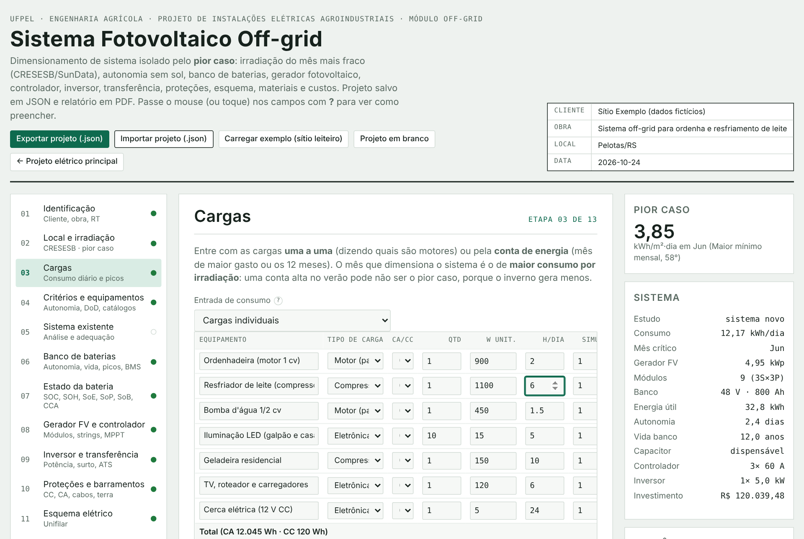

---

## Sumário

1. [Como abrir](#como-abrir)
2. [Balões de ajuda](#balões-de-ajuda)
3. [Etapas](#etapas)
4. [Métodos de cálculo](#métodos-de-cálculo)
5. [Projeto em JSON](#projeto-em-json)
6. [Relatório em PDF](#relatório-em-pdf)
7. [Consulta ao CRESESB (sundata.php)](#consulta-ao-cresesb-sundataphp)
8. [Limitações e aproximações](#limitações-e-aproximações)
9. [Normas e referências](#normas-e-referências)
10. [Arquivos](#arquivos)

---

## Como abrir

**Com PHP (recomendado; ativa a busca automática no CRESESB)**

```bash
cd app-projetos-de-instalacoes-eletricas-agroindustriais
php -S localhost:8000
```

Abra `http://localhost:8000/offgrid/index.html`, ou use o botão **Módulo off-grid** no app principal.

**Sem PHP (GitHub Pages ou duplo clique no `index.html`)**

Funciona tudo, menos a busca automática no CRESESB. Nesse caso use:

- **Consulta manual**: abra o SunData, consulte a coordenada, copie a tabela de resultado e cole na etapa 02.
- **NASA POWER**: climatologia mensal com as inclinações calculadas pela ferramenta. Serve como alternativa; confira com o CRESESB no projeto oficial.

O rascunho fica guardado no navegador (localStorage). Para guardar de verdade, use **Exportar projeto (.json)**.

## Balões de ajuda

Todo campo com **?** tem um balão que explica **o que é, onde obter o dado e que valores são usuais**. Ele aparece ao passar o mouse, ao tocar no celular ou ao entrar no campo com o teclado. As colunas das tabelas (cargas, águas do telhado, analisador de baterias, meses da conta, preços) também têm balões. A tecla Esc fecha o balão.

| Campo | Coluna de tabela |
|---|---|
| 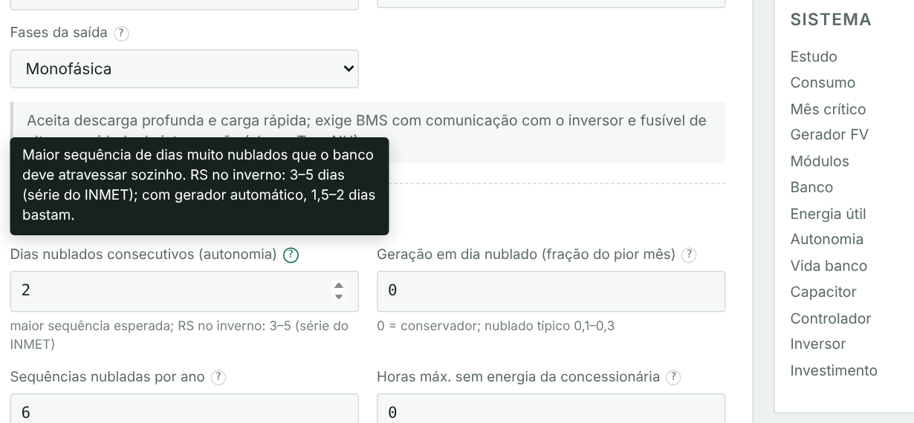 | 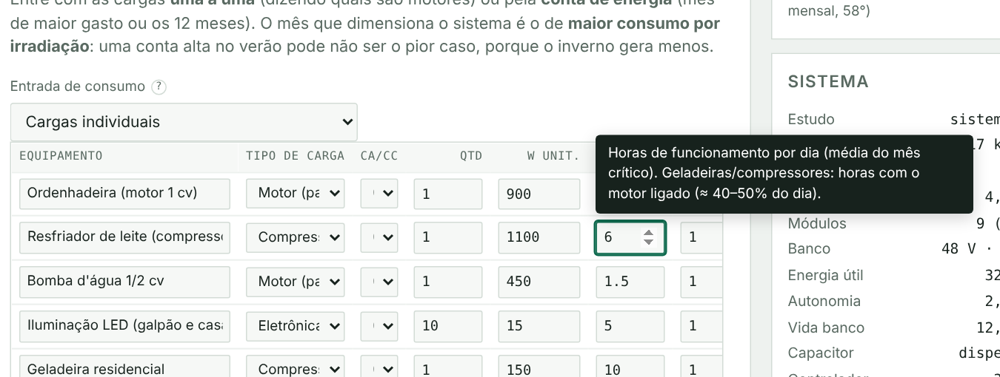 |

## Etapas

| # | Etapa | O que preencher | O que sai |
|---|---|---|---|
| 01 | Identificação | cliente, obra, RT; **tipo de estudo**: sistema novo ou análise de existente | carimbo e capa |
| 02 | Local e irradiação | coordenada (ou localização atual); CRESESB automático, colado ou NASA POWER; temperaturas mínima e máxima; **águas do telhado** (opcional) | HSP do pior caso, captação de cada água |
| 03 | Cargas | **cargas uma a uma** (tipo: resistiva, eletrônica, motor, compressor, soft-starter, inversor de frequência; crítica ou não) **ou conta de energia** (mês de maior gasto ou 12 meses + variação anual) | consumo, potência simultânea, surto, **mês de dimensionamento** |
| 04 | Critérios e equipamentos | dias nublados, falta da concessionária, recuperação, temperatura do abrigo, pico de partida; tecnologia e dados de catálogo de módulo, bateria, controlador e inversor | — |
| 05 | Sistema existente | (modo análise) módulos em série e strings, baterias em série e paralelo, controladores, inversores, seção dos cabos, fusível do banco | necessário × existente, recomendações, lista de adequação |
| 06 | Banco de baterias | — | capacidade, série × paralelo, DoD, vida útil (Miner + temperatura), picos e capacitor, CCA, BMS e balanceamento |
| 07 | Estado da bateria | medições: tensão em repouso, capacidade, resistência, CCA, tensões máx./mín., teste de carga; **dados do analisador** (uma linha por bateria ou CSV colado) | SOC, SOH, SoE, SoP, SoB, CCA, vida restante, baterias a trocar |
| 08 | Gerador FV e controlador | — | módulos, strings, janela de tensão com a temperatura, controladores, arranjo por água |
| 09 | Inversor e transferência | fonte reserva (gerador ou rede) e tipo de chave (automática ou manual) | inversor, surto, gerador, chave |
| 10 | Proteções e barramentos | comprimentos e quedas de tensão | fusíveis, seccionadoras, DPS, DR, **cabos por trecho com PE**, **barramentos**, **comparação 12/24/48 V** |
| 11 | Esquema elétrico | — | unifilar (SVG e PDF) |
| 12 | Materiais e custos | preços unitários, horas, deslocamento, BDI, impostos | lista de materiais (ou de adequação), total, R$/Wp, custo da energia em 25 anos |
| 13 | Relatório | — | PDF e JSON |

<details><summary>Telas das etapas</summary>

**02 · Local e irradiação**
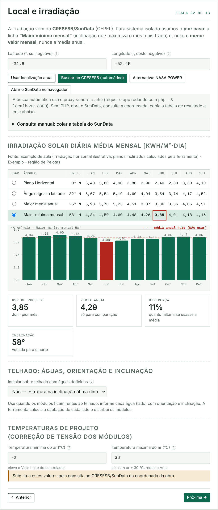

**03 · Cargas**
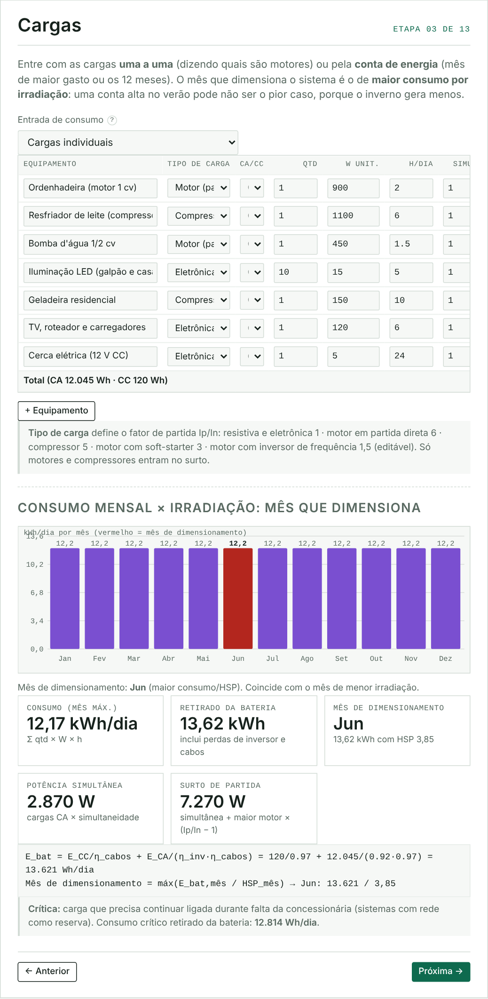

**06 · Banco de baterias**
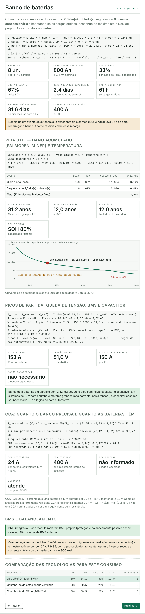

**07 · Estado da bateria**
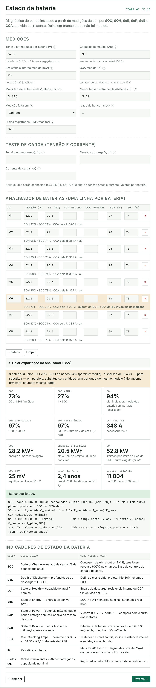

**08 · Gerador FV**
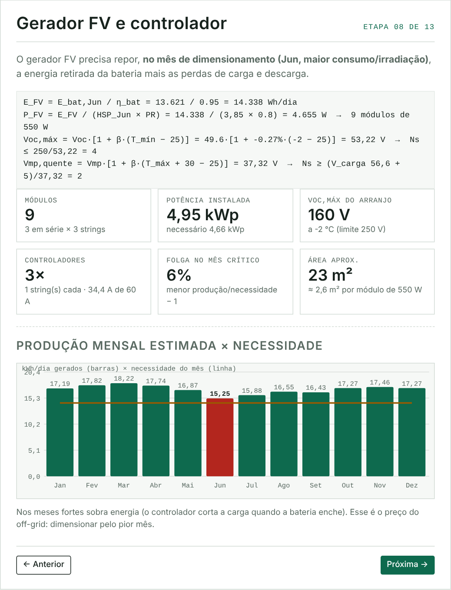

**10 · Proteções, cabos e barramentos**
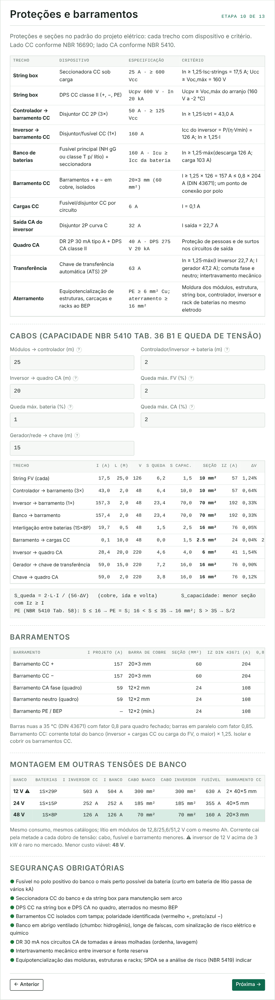

**11 · Unifilar**
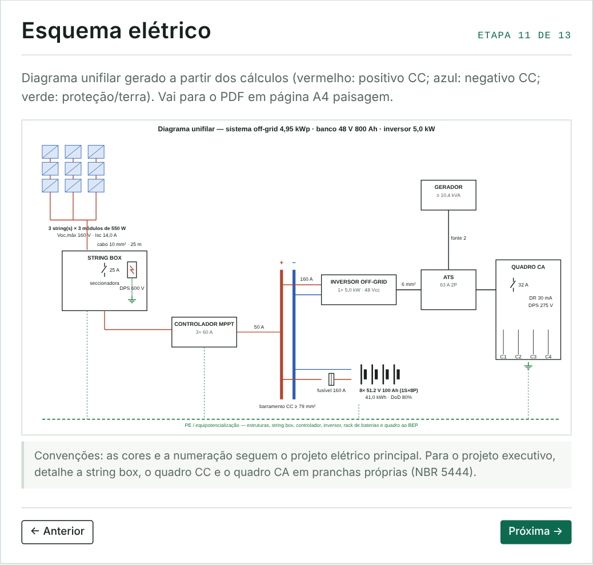

**12 · Materiais e custos**
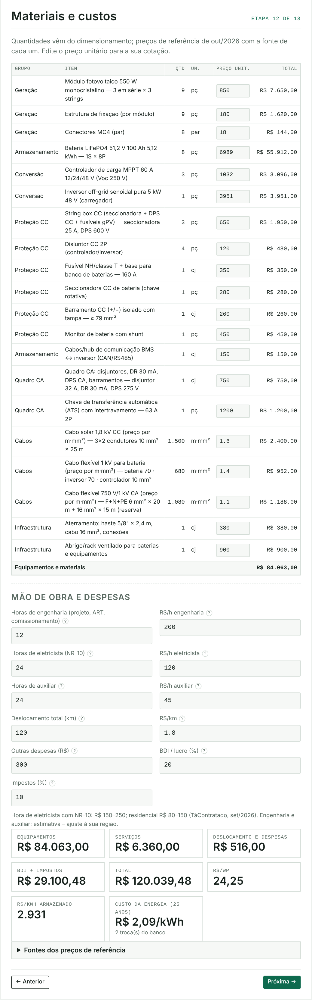

</details>

## Métodos de cálculo

### Irradiação: pior caso

O CRESESB/SunData dá a irradiação diária média mensal (kWh/m²·dia) em quatro planos: horizontal, inclinação igual à latitude, **maior média anual** e **maior mínimo mensal**. No off-grid usa-se a linha **maior mínimo mensal** e, nela, o menor mês. Em kWh/m²·dia, o valor é igual às horas de sol pleno (HSP).

### Telhado com uma ou mais águas

Para cada água, informe:

- **Orientação**: N, NE, L, SE, S, SO, O, NO ou graus (N = 0°, L = 90°, S = 180°, O = 270°).
- **Inclinação**: em graus ou em caimento %. A conversão é β = arctan(caimento/100); 30% = 16,7°.
- **Medidas**: comprimento e largura da água.

A irradiação de cada água é calculada **hora a hora no dia médio do mês**:

- distribuição horária da global e da difusa por Collares-Pereira & Rabl;
- fração difusa de Erbs;
- radiação direta projetada pelo ângulo de incidência cos θ (Duffie & Beckman);
- difusa isotrópica e albedo 0,2.

O resultado é **calibrado** pela linha selecionada do SunData, mês a mês. A **captação** da água é a irradiação dela dividida pela irradiação na inclinação ótima, calculada no pior mês e na média anual.

**Quantos módulos cabem** em cada água, montados em grade, em retrato ou em paisagem:

```
N = ⌊(L − 2r + g)/(a + g)⌋ · ⌊(W − 2r + g)/(b + g)⌋
```

- r = recuo das bordas (padrão 0,4 m);
- g = folga dos grampos (2 cm);
- a, b = lados do módulo;
- W na planta é convertida para o plano do telhado: W/cos β.

Por isso a área ocupada pelos módulos é sempre menor que a área da água.

Os módulos vão primeiro para a água que mais rende no mês com falta de energia, até encher essa água. Cada água forma suas próprias strings e tem MPPT próprio.

### Consumo e mês de dimensionamento

Duas formas de entrar o consumo:

- **Cargas individuais**: E = Σ quantidade · W · h. A potência simultânea usa o fator de simultaneidade. O surto é a simultânea mais o maior motor × (Ip/In − 1), e só motores e compressores entram no surto.
- **Conta de energia**: os meses sem dado seguem a curva E_m = E_pico · [1 − a·(1 − cos(2π(m − m_pico)/12))/2], onde a é a variação anual informada.

A energia retirada da bateria é E_bat = E_CC/η_cabos + E_CA/(η_inv·η_cabos).

O **mês de dimensionamento** é o de maior E_bat,m/HSP_m. Uma conta alta no verão pode não ser o pior caso, porque o inverno gera menos.

### Banco de baterias

```
E_nublado = E_bat · N_nub · (1 − f_nub)
E_falta   = E_crítica · h_falta / 24
C [Wh]    = máx(E_nublado; E_falta) / (DoD · f_T)
C [Ah]    = C[Wh] / V_banco
Ns = V_banco / V_unid      Np = ⌈C / Ah_unid⌉
```

Tempo de recarga depois do evento: t = E_aut / [(P_FV·HSP·PR − E_FV)·η_bat], no pior mês.

Opcionalmente, "dias para recuperar" aumenta o gerador FV para encurtar esse tempo.

### Vida útil

Pela regra de Palmgren-Miner, o dano por ano é Dano = Σ nᵢ / N(DoDᵢ), somando:

- o ciclo diário;
- as sequências nubladas;
- as faltas da concessionária.

Cada termo usa a curva ciclos × DoD da tecnologia, interpolada em escala log-log.

O efeito da temperatura do abrigo entra como f_T = 2^((T − 25)/10).

A vida útil é o menor de dois valores: 1/(Dano·f_T) e a vida de calendário dividida por f_T. O fim de vida é SOH = 80%.

### Picos de partida, capacitor e CCA

```
I_pico   = P_surto / (η · V_ref)              (V_ref = tensão em repouso no DoD máximo)
R_banco  = R_i · Ns/Np + R_cabos
V_queda  = V_ref − I_pico · R_banco ≥ V_corte + 2%
C_cap    ≥ I_exc · t / (ΔV − I_exc · ESR)     (supercapacitores 16 V; pré-carga ≈ V/5 A)
CCA_nec  = (12,6 − 7,2) / (k_frio · R_12V,máx)
CCA_esp  = (12,6 − 7,2) / (k_frio · R_12V,catálogo)
```

- I_exc é a parte do pico que as baterias não fornecem.
- O CCA é dado em equivalente de 12 V; k_frio ≈ 1,8.
- Regra do som automotivo, para comparação: 1 F por kW em 12 V, convertido proporcionalmente à tensão.

### BMS e balanceamento

- **Lítio em módulo rack**: o BMS já vem no módulo. Com módulos em paralelo, é preciso ligar mestre/escravo e a comunicação CAN/RS485 com o inversor.
- **Lítio em células avulsas**: BMS externo dimensionado para 1,25 × a corrente máxima, com balanceamento ativo de corrente I_bal ≥ 0,03·C/4 h.
- **Chumbo em série**: Ns − 1 balanceadores; bateria ventilada precisa também de carga de equalização periódica.

### Estado da bateria

| Indicador | Cálculo |
|---|---|
| SOC | tensão em repouso convertida pela curva da tecnologia (LiFePO4 tem curva plana: prefira o SOC do BMS) |
| SOH | mín(C_medida/C_nominal; 1 − 0,2·(R_medida − R_nova)/R_nova; CCA_medido/CCA_nominal; SOH do analisador) |
| SoE | SOC · SOH · E_nominal |
| SoP | mín[V_corte·(V_ocv − V_corte)/R_banco; V_corte·Np·I_pico,BMS] |
| SoB | ΔV entre células ou baterias, comparado a 30 mV/célula (lítio) ou 50 mV/célula (chumbo) |
| Teste de carga | R_i = (V₀ − V₁)/I, convertida em CCA equivalente |
| Vida restante | mín(vida de projeto − idade; (SOH − 0,8)/perda anual) |

Analisador de baterias:

- Banco em série: o SOH do banco é o da **pior bateria**.
- Banco em paralelo: o SOH do banco é a **média**.
- Uma bateria é marcada se tiver SOH < 80%, Ri 25% acima da mediana ou CCA abaixo do necessário.

### Gerador FV e controlador

```
P_FV = (E_FV + E_rec) / (HSP_mês · PR)
Voc,máx = Voc·[1 + β(T_mín − 25)]           → Ns ≤ V_máx,ctrl / Voc,máx
Vmp,q   = Vmp·[1 + β(T_máx + 30 − 25)]      → Ns ≥ (V_carga + 5) / Vmp,q
I_ctrl = P_FV,ctrl / V_banco ≤ I_máx        P_FV,ctrl ≤ P_máx(V_banco)
```

### Inversor e transferência

```
P_inv ≥ 1,25 · P_simultânea        surto ≤ k_s · P_inv        I_CC = P_inv / (η · V_mín)
P_gerador ≥ 1,25 · (P_sim + P_carregador)     I_chave ≥ 1,25 · máx(I_inv; I_gerador)
```

A chave comuta **fase e neutro**, com intertravamento mecânico.

### Proteções, cabos e barramentos

- **Lado FV**:
  - fusível gPV quando há 3 ou mais strings no mesmo MPPT, com 1,5·Isc ≤ In ≤ 2,4·Isc;
  - seccionadora CC de no mínimo 1,25·Isc·strings;
  - DPS CC com Ucpv ≥ Voc,máx.
- **Banco**: fusível NH ou classe T de no mínimo 1,25·máx(I de descarga; I de carga), instalado junto ao polo positivo.
- **Cabos, trecho a trecho**: string, arranjo, controlador, inversor, banco, interligação entre baterias, cargas CC, saída CA, gerador até a chave e chave até o quadro.
  - A seção é a maior entre a **capacidade** (NBR 5410, Tab. 36, B1) e a **queda de tensão**, S = 2·L·I/(56·ΔV).
  - O condutor de proteção (PE) segue a Tab. 58.
- **Barramentos**: barras de cobre retangulares pela DIN 43671, nuas a 35 °C, com fator 0,8 em quadro fechado.
- **Comparação 12/24/48 V**: o projeto é refeito nas três tensões, com o mesmo consumo e os mesmos catálogos.

### Análise de sistema existente

Os valores instalados substituem os dimensionados. A ferramenta compara item a item:

- potência FV;
- módulos em série;
- tensão e capacidade do banco;
- controladores;
- inversor;
- cada cabo;
- fusível;
- pico de partida.

A etapa 12 passa a listar só a **adequação**:

- módulos e strings que faltam;
- banco novo ou ampliação em paralelo (lítio rack);
- controladores adicionais;
- troca do inversor;
- recabeamento;
- banco capacitivo.

## Projeto em JSON

Formato `offgrid-agro`, versão 1. Exemplo: [`offgrid-exemplo-sitio-leiteiro.json`](offgrid-exemplo-sitio-leiteiro.json).

| Chave | Conteúdo |
|---|---|
| `id` | cliente, obra, local, município, RT, CREA, data |
| `modo` | `novo` ou `existente` |
| `local` | latitude, longitude, fonte, estação e linhas do SunData (`rows`), linha selecionada (`sel`) |
| `temp` | temperaturas mínima e máxima |
| `telhado` | `usar`, recuo, forma de medir e `faces` (nome, orientação, inclinação, comprimento, largura, módulos) |
| `entrada`, `cargas`, `conta` | consumo por cargas ou pela conta |
| `crit` | autonomia, falta, recuperação, temperatura, pico, tecnologia, DoD, PR, rendimentos |
| `eq` | catálogos de módulo, bateria, controlador e inversor |
| `exist` | sistema instalado (modo análise) |
| `estado`, `analise` | medições e dados do analisador de baterias |
| `backup`, `cabos`, `precos`, `mo` | reserva e chave, comprimentos, preços com fonte, mão de obra e BDI |
| `resultados` | resumo calculado ao exportar (somente leitura) |

Para importar, use **Importar projeto (.json)**. Campos que faltem no arquivo recebem os valores padrão.

## Relatório em PDF

Gerado no navegador com pdf-lib, com 8 a 10 páginas:

- capa com resumo;
- recurso solar e pior caso, incluindo as águas do telhado;
- cargas e consumo mensal;
- banco de baterias:
  - autonomia;
  - vida útil;
  - picos e capacitor;
  - CCA;
  - BMS;
  - estado e analisador;
- gerador FV e controlador;
- inversor e transferência;
- proteções, cabos, barramentos e comparação de tensões;
- análise do sistema existente;
- diagrama unifilar em A4 paisagem;
- materiais, mão de obra, BDI e indicadores.

## Consulta ao CRESESB (sundata.php)

O SunData não tem API pública documentada. O `sundata.php` envia o formulário do SunData pelo servidor PHP local, o que contorna a restrição de CORS do navegador. Em seguida converte o HTML em texto e devolve `{ ok, fonte, url, consulta, texto }`, e a página lê a tabela com o mesmo leitor da consulta manual.

Se o CRESESB mudar o formulário e a busca automática falhar:

1. Abra o SunData no navegador e faça uma consulta.
2. Abra as ferramentas do desenvolvedor (F12) → **Rede** e veja os campos enviados.
3. Ajuste os nomes no array `$campos` do `sundata.php`.

Enquanto isso, a consulta manual (colar a tabela) continua funcionando.

## Limitações e aproximações

- O exemplo do sítio leiteiro usa **irradiação ilustrativa**. Para um projeto real, consulte o SunData da coordenada da obra.
- Curvas ciclos × DoD, resistência interna e limites de corrente das baterias são **valores típicos**: substitua pelos do catálogo.
- O CCA é estimado pela resistência interna, pela mesma relação usada nos analisadores de condutância. **Não** é feita conversão entre normas (SAE, EN, DIN, JIS); compare sempre na mesma norma. LiFePO4 não tem CCA normalizado, e o valor mostrado é um equivalente.
- A curva anual da conta (cosseno) é uma suposição. Com os 12 meses da conta, ela não é usada.
- O modelo de irradiação por água assume difusa isotrópica e não considera sombreamento por obstáculos, platibandas, árvores ou cumeeiras vizinhas.
- Os preços são referências de out/2026, com fonte indicada; os itens marcados "estimativa – confirmar cotação" precisam de cotação.
- A ferramenta é didática: não substitui a verificação do responsável técnico, os dados de catálogo dos equipamentos escolhidos nem as exigências da distribuidora.

## Normas e referências

- ABNT NBR 16690:2019 — Instalações elétricas de arranjos fotovoltaicos
- ABNT NBR 5410:2004 — Instalações elétricas de baixa tensão (Tab. 36 e 58)
- ABNT NBR 5419:2015 — Proteção contra descargas atmosféricas
- ABNT NBR 16274 — Sistemas fotovoltaicos: documentação e ensaios
- ABNT NBR 14298 / IEC 62509 — Controladores de carga · IEC 62109 — Conversores
- ABNT NBR 15389 / IEC 62619 — Baterias · SAE J537 — CCA
- DIN 43671 — Barramentos de cobre
- CRESESB/CEPEL — SunData v3.0 (Atlas Brasileiro de Energia Solar, INPE, 2017)
- PINHO, J. T.; GALDINO, M. A. *Manual de Engenharia para Sistemas Fotovoltaicos*. CEPEL/CRESESB, 2014
- DUFFIE, J. A.; BECKMAN, W. A. *Solar Engineering of Thermal Processes* (Liu-Jordan, Erbs, Collares-Pereira & Rabl)
- NASA POWER — climatologia mensal

## Arquivos

```
offgrid/
├── index.html                          página do módulo
├── offgrid.js                          cálculos, interface, balões de ajuda, esquema, JSON e PDF
├── offgrid.css                         estilos complementares ao css/style.css do app
├── sundata.php                         proxy local para o CRESESB/SunData
├── offgrid-exemplo-sitio-leiteiro.json projeto de exemplo da aula
├── LEIAME.txt                          instruções rápidas
├── README.md                           esta documentação
└── docs/img/                           capturas de tela usadas aqui
```

---

Responsáveis: Marlon Soares Sigales, Ádamo de Souza Araújo e Ricardo Scherer Pohndorf — Laboratório de Instrumentação Agrícola, Engenharia Agrícola, CEng/UFPel. Uso conforme o arquivo [LICENSE](../LICENSE) do repositório.
